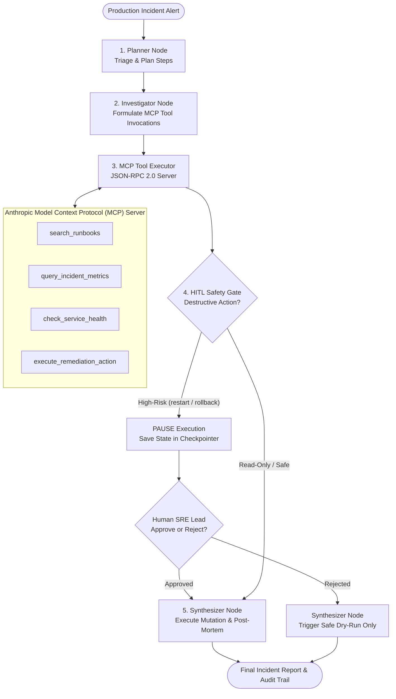

# AgenticOps MCP | Autonomous Incident Response & SRE Copilot

<div align="center">


<br/>

**Stateful Multi-Agent Workflow powered by LangGraph, Anthropic Model Context Protocol (MCP), and Human-in-the-Loop (HITL) Safety Gates.**  
*Automates microservice triage, queries live telemetry & runbooks via MCP, interrupts on high-risk mutations, and synthesizes root-cause post-mortems.*

</div>

---

## 1. System Architecture



---

## 2. Key Technical Innovations

| Pillar | Technical Implementation | Why It Matters in Production |
|---|---|---|
| **LangGraph Cyclic Graph** | StateGraph with in-memory `MemorySaver` checkpointer and conditional edges | Replaces brittle linear DAG chains with loops, retry logic, and state resumption |
| **Model Context Protocol (MCP)** | JSON-RPC 2.0 implementation (`tools/list`, `tools/call`, `resources/read`) | Standardizes tool discovery across diverse microservices and LLM providers |
| **Strict Function Calling** | Pydantic v2 typed schemas (`Field`, validation, constraints) | Eliminates tool invocation hallucination and parameter format errors |
| **Human-in-the-Loop (HITL)** | Conditional interrupt on high-risk mutations (`restart_pods`, `rollback_release`) | Prevents autonomous agents from causing catastrophic production outages |
| **Dual-Mode Resiliency** | Zero-dependency high-fidelity simulation + real Gemini/OpenAI caller | Fully runnable offline and for live demos without paying API fees |

---

## 3. Quickstart Run Guide

### Option A: Run Backend (FastAPI + LangGraph)
```bash
cd backend

# 1. Install dependencies
pip install -r requirements.txt

# 2. Run test suite (All 12 unit tests pass in <1 sec)
pytest -v

# 3. Start server
uvicorn app.main:app --host 127.0.0.1 --port 8000 --reload
```
> Interactive API Docs (Swagger): **`http://127.0.0.1:8000/docs`**

---

### Option B: Run Frontend Dashboard (React + Vite)
```bash
cd frontend

# 1. Install packages
npm install

# 2. Start developer console
npm run dev
```
> App launches on: **`http://localhost:5175`**

---

## 4. API Endpoints

### 1. Model Context Protocol (MCP)
- `POST /api/v1/mcp`: Standard MCP JSON-RPC 2.0 gateway (`tools/list`, `tools/call`, `resources/list`).
- `GET /api/v1/mcp/tools`: Discover registered MCP tools with JSON schemas and approval requirements.
- `GET /api/v1/mcp/resources`: List internal runbooks and operational resources.

### 2. LangGraph Agent Orchestration
- `POST /api/v1/agent/run`: Dispatch autonomous incident triage. Returns `waiting_approval` if high-risk.
- `GET /api/v1/agent/runs/{run_id}`: Inspect checkpointer state, execution graph, and audit log.
- `POST /api/v1/agent/runs/{run_id}/approve`: Resume LangGraph execution from checkpoint with human approval.
- `POST /api/v1/agent/stream`: Server-Sent Events (SSE) stream of node transitions.

---

## 5. Senior GenAI Engineer Interview Q&A (Talking Points)

### Q1: Why use LangGraph instead of traditional LangChain sequential chains (DAGs)?
> *"Sequential chains (DAGs) only execute linearly from A to B. Real-world agents require cyclic execution loops: they must plan, observe telemetry, evaluate whether the result is satisfactory, and retry or pivot if something fails. LangGraph models the agent as a stateful finite-state machine with persistence/checkpointers, allowing us to pause state at any node (e.g. for human approval) and resume without re-running prior steps."*

### Q2: What is Anthropic's Model Context Protocol (MCP) and why is it important?
> *"Before MCP, every developer wrote custom ad-hoc tool wrappers for their LLMs. MCP is an open standard that uses JSON-RPC 2.0 to define how AI applications discover tools (`tools/list`), execute capabilities (`tools/call`), and read external contexts (`resources/read`). It creates an ecosystem where any MCP tool can be plugged into any agentic workflow seamlessly."*

### Q3: How do you implement Human-in-the-Loop (HITL) safely in an autonomous agent?
> *"We classify actions into read-only queries (e.g., `query_incident_metrics`) vs. destructive mutations (e.g., `restart_pods`, `rollback_release`). When the Investigator node proposes a destructive action, the HITL gate node intercepts execution, pauses the graph, saves the thread state in the checkpointer, and marks the status as `waiting_approval`. Only when a human operator verifies the proposed change and posts an approval token does the graph resume into the Synthesizer node."*

### Q4: How do you prevent LLM hallucination during tool calling?
> *"We bind strict Pydantic v2 schemas to each MCP tool definition. The LLM must output valid JSON matching the schema types, allowed enums, and range constraints (e.g., `window_hours: int = Field(..., ge=1, le=72)`). If parsing fails, validation errors are caught before any system execution occurs."*

---

## 6. Project Structure

```text
D:\agentic-ops-mcp/
├── backend/
│   ├── app/
│   │   ├── core/           # Configuration & environment settings
│   │   ├── graph/          # LangGraph state, nodes, and compiled workflow
│   │   │   ├── state.py    # IncidentState TypedDict & AgentStep schemas
│   │   │   ├── nodes.py    # Planner, Investigator, MCP Executor, HITL Gate, Synthesizer
│   │   │   └── workflow.py # StateGraph compilation with MemorySaver checkpointer
│   │   ├── mcp/            # Model Context Protocol (MCP) JSON-RPC 2.0 server
│   │   │   └── server.py   # Tool registry, Pydantic schemas, and runbook resources
│   │   ├── routers/        # /agent, /mcp, and /health endpoints
│   │   └── main.py         # FastAPI application entrypoint with CORS
│   ├── tests/              # 12 automated unit tests (test_mcp, test_graph, test_api)
│   ├── requirements.txt    # Python dependencies (langgraph, fastapi, pydantic)
│   └── Dockerfile          # Containerized deployment
│
├── frontend/               # React 18 + Vite + Tailwind v4 Dashboard
│   ├── src/
│   │   ├── App.jsx         # Graph visualizer, HITL approval modal, MCP tools explorer
│   │   ├── main.jsx        # Mounting
│   │   └── index.css       # Tailwind v4 styles
│   ├── package.json
│   └── vite.config.js
│
├── docker-compose.yml      # Container orchestration
└── README.md               # Technical documentation & interview guide
```

---

## 7. License
MIT License. Created by [Bhavika Hotwani](https://github.com/bhavika-hotwani-tech).
